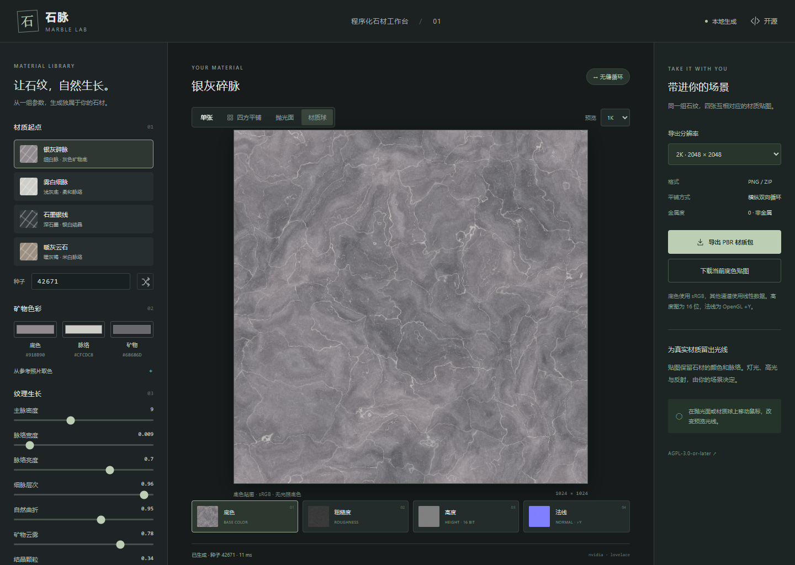

# 石脉 · Marble Lab

在浏览器本地生成无缝灰脉石材的 WebGPU 应用。调整矿物色彩、主脉密度、细脉、域扭曲和表面质感，导出可以用于 D5、Blender、Unreal 等软件的材质贴图。



## 运行

需要 Node.js 22 或更新版本、pnpm，以及支持 WebGPU 的 Chrome / Edge。页面须通过 localhost 或 HTTPS 打开，浏览器硬件加速需要开启。

```sh
pnpm install
pnpm dev
```

打开 <http://127.0.0.1:8150/>。端口占用时会报错，不会悄悄改用另一个端口。

```sh
pnpm typecheck
pnpm test
pnpm build
pnpm preview
```

构建产物位于 `dist/`，可部署到 HTTPS 静态站点。应用无后端、无账号、无远程推理；生成与照片取色均在本地完成。除用户主动打开许可证或源码链接外，应用不请求外部服务。

## 使用

1. 选择“银灰碎脉”“雾白细脉”“石墨银线”或“暖灰云石”。
2. 调整色彩、脉络和表面参数。种子不变时，同一设备和同一版本的输出可复现。
3. 使用“四方平铺”查看接缝，使用“抛光面”或“材质球”观察光线。鼠标位置控制预览光源。
4. 选择 1K、2K 或 4K 导出尺寸，下载单通道 PNG 或整套 ZIP。
5. “保存参数”下载 JSON，“载入参数”恢复材质。当前参数也会保存在浏览器本地。

“从参考照片取色”可载入本地图片，点击图片设置底色。图片不会上传，也不会自动转换成无缝材质。石纹由程序生成，目的是生成同类材料，不能精确复制照片中的每条纹路。

## 导出约定

| 文件 | 精度 | 颜色空间 | 用途 |
| --- | --- | --- | --- |
| `*_basecolor.png` | 8 位 RGB | sRGB | 无烘焙光照的底色 |
| `*_roughness.png` | 8 位 | Linear / Non-Color | R 通道，白色更粗糙 |
| `*_normal_OpenGL.png` | 8 位 RGB | Linear / Non-Color | 切线空间 OpenGL +Y 法线 |
| `*_height_16bit.png` | 16 位灰度 | Linear / Non-Color | 相对高度，0.5 为中性值 |
| `preset.json` | JSON | — | 完整生成参数 |
| `material.json` | JSON | — | 文件名、通道和色彩约定 |

金属度设为 0。需要 DirectX 法线的渲染器应反转绿色通道。若软件使用光泽度，应使用 `1 - roughness`。高度不是实际毫米测量值，置换幅度由场景比例决定；抛光石材建议从很小的幅度开始。

抛光高光仅存在于预览照明中，不会写入底色。材质球是 GGX 近似预览，并非产品扫描或渲染器标定结果。

## 无缝原理

- 使用整数周期的二维梯度平滑值噪声与周期 Voronoi 晶胞。只包裹哈希索引，距离计算使用展开坐标。
- 主脉、次级脉、细脉和所有域扭曲均为周期场；不使用边缘模糊或镜像拼接。
- 第一遍 compute shader 生成底色、粗糙度和 `r32float` 高度。
- 第二遍读取周期邻域，以中心差分计算法线。边缘像素从对侧取高度，避免独立法线接缝。
- 常规贴图在像素中心采样。首尾像素是相邻采样点，通常不应相同；验证模式单独采样参数域的 0 与 1 端点。
- 高度在 GPU 中保留浮点精度，导出时编码为真正的 16 位灰度 PNG。不会先转成 8 位画布再扩展。

重复材质仍然会重复其大尺度结构。“无缝”保证边界连续，不代表无限平铺后没有可辨认的重复图案。

## 工程结构

```text
src/
  params.ts                 参数范围、预设格式、uniform 打包
  gpu.ts                    设备、管线、资源生命周期和回读
  export.ts                 PNG / 16 位高度 / ZIP 导出
  main.ts                   参数交互、串行生成队列、导出流程
  style.css                 桌面与移动布局
  shaders/material.wgsl     周期石材场
  shaders/normal.wgsl       周期高度导数
  shaders/preview.wgsl      通道查看与材质照明
scripts/verify-browser.ts   真实 GPU 与浏览器验收
tests/material.test.ts      参数契约与 PNG 编码检查
```

源码中的算法注释使用中文。GPU 生成没有 CPU 或 WebGL 替代实现；设备不可用或断开时显示明确错误。

## 验证

```sh
# 先在另一个终端运行 pnpm dev
pnpm test:browser
```

默认使用本机 Microsoft Edge。可设置 `MARBLE_BROWSER=chrome` 和 `MARBLE_TEST_URL` 指向其他兼容环境。生产版本使用 `?verify` 查询参数打开测试入口。

浏览器检查实际执行 WGSL，覆盖：

- 周期域端点误差，以及包含边缘在内的法线与高度差分一致性。
- 同种子逐字节复现、不同种子变化、非对齐行距 GPU 回读。
- 1K/2K/4K 生成，2K ZIP 全通道下载，4K 16 位高度下载。
- JSON 保存与恢复、损坏预设提示、参考图取色、移动布局及控制台错误。

截图、贴图与报告写入忽略版本控制的 `artifacts/`。性能受显卡、浏览器和参数影响；本机 NVIDIA Lovelace 的一次测试中，1K/2K/4K 计算及显示约为 10/47/152 ms，PNG 编码和压缩时间另计。

## 许可证

Copyright © 2026 leolee9086 & 织。

源码采用 [AGPL-3.0-or-later](LICENSE)，无担保。这里独立实现了周期石材生成逻辑，没有复制参考照片或把参考照片打包进源码。

本项目不对纯程序化生成的贴图主张额外许可限制；这些输出可用于个人或商业项目。上传参考图片的权利由图片自身的许可决定。
